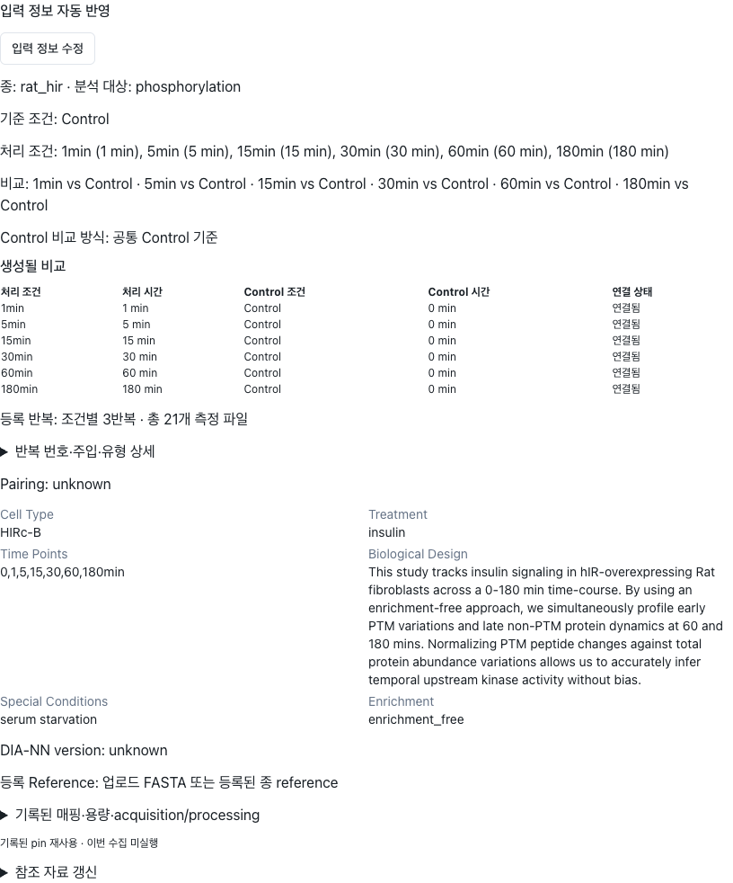

# C05-A — 실제 입력 연결 및 패키지 검증

작성: 2026-11-07. 대상: `Xformyx/PTM-platform`, 로컬 `main`.

## 기준과 범위

시작 HEAD는 요청 기준 `f1b028fada14d5646b829ae6b15b04afeedff17f`와 정확히 같았다. origin은 `https://github.com/Xformyx/PTM-platform.git`이다. 추적 파일은 깨끗했고 기존 untracked `codex-inputs/`를 보존했다. `CONTROL_COMPARISON_UPGRADE_KO.md`의 C01–C03 구현과 합성/SQLite·대역 검증 범위를 읽고 기존 resolver·정량·발행·reader 도구를 재사용했다.

이번 검증은 **실제 HIRc-B 공통 Control 입력을 격리된 로컬 주문으로 복원한 검증**이다. 운영 주문 DB나 운영 UI를 검증한 것이 아니다. 실제 시간대별 Control 입력은 접근 가능한 로컬 저장 설계 inventory에서 찾지 못했다. Control 파일 복제·이름 변경으로 실제 matched 자료를 만들지 않았다. 따라서 **실제 time-matched 실행 검증은 미완료**다.

C04 통계, Legacy 신규 지원, native PhosX 재계산, 신규 외부 RAG/LLM 호출, push·배포·feature flag 변경은 수행하지 않았다. 생산 코드의 연결 결함으로 확정된 수정은 없으며, 산출물은 검증 runner·UI 검증 shell·증거·보고서다.

## 실제 자료와 보존 기준

기준 패키지: `codex-inputs/g11-followup-04/delivery/G11_R04_LOCAL/enrichment_free_runs/g3-173714b8042a41afa0248b88dc49d4c3`.

이 패키지의 과학 표는 실제 HIRc-B PR/PG 입력에서 유래한 보존 표다. 이전 G11 전달 검증은 과학 단계 대역을 사용했으므로, 그 전달 run 자체가 새 과학 계산을 했다고 주장하지 않는다. 이번에는 실제 원본 PR/PG를 현재 정량 함수로 계산해 이 표들과 비교했다.

| 입력 | bytes | SHA-256 |
| --- | ---: | --- |
| PR | 60,879,325 | `7160e863ddaf5236d22c5dc95fd3b066355341e8b2b130f11ef12e5a46a52ba4` |
| PG | 2,925,895 | `57c874a46f57608a64a779c4ef8ddecd07273cc0603aa228b8fbd662cbfca745` |
| FASTA | 40,303,302 | `61b5d367511111d46377c78cfcfc1a09bacb0c1632c9960282520de732823c83` |
| 기록된 specificity manifest | 2,027 | `1f0f262e684276d95672f33ba79f7e2ff7e1d6b8f7a8d5d6cddce2874380a605` |

Source pin: `2566fabd9cab0bab1ebeedf55326652ae7808467c9715b00a3a29a1dd91f6160`. 격리 reference registry가 비어 있어 첫 preview는 정상적으로 pin 부재 오류를 반환했다. 보존 `source_pin.json`의 wrapper를 제외한 원래 serializer bytes를 재구성하고 위 digest와 일치하는 것을 확인한 뒤 기존 `pin_sources()`로 등록했다. 외부 조회·새 pin 선택은 없었다. 패키지 파일 자체 hash와 content-addressed pin hash는 다른 값으로 기록했다.

원본 manifest 257개 파일을 hash 검증했다. 기존 ZIP hash는 `862be7cbefcd42c24769ea0a6530bc6ba2b1f0fb2f4fa22931d1886e727f19af`다. 원본 저장 snapshot·설계·source/literature pin과 성공 pointer는 읽기 전용으로 취급했다.

| 저장 조건 | 실제 숫자 시간(분) | 등록 Rep. IDs | 고유 주입 | material / sampled unit |
| --- | ---: | --- | ---: | ---: |
| Control | 0 | 1, 2, 3 | 3 | 1 |
| 1min | 1 | 1, 2, 3 | 3 | 1 |
| 5min | 5 | 1, 2, 3 | 3 | 1 |
| 15min | 15 | 1, 2, 3 | 3 | 1 |
| 30min | 30 | 1, 2, 3 | 3 | 1 |
| 60min | 60 | 1, 2, 3 | 3 | 1 |
| 180min | 180 | 1, 2, 3 | 3 | 1 |

이는 각 condition_id에 속한 실제 `legacy_replicate`, `input_column`, `injection_id`, `material_id`에서 집계했다. 21을 7로 나누어 추정한 값이 아니다. 전체 21주입·7 material, 저장 선언 `technical_per_condition`, 모든 contrast의 pairing `unknown`, 명시 pair ID는 없다. ID 전체는 [실제 입력 증거](control_c05a_evidence/actual-input.json)에 보존한다.

## UI → 저장 → 실행 경계

| 경계 | 검증 방법 | 경계/제한 |
| --- | --- | --- |
| 최초 입력 공통 컴포넌트 | 실제 저장 snapshot을 `StudyInputFields`에 전달, 두 radio 선택·서버 preview | 실제 OrderCreate 전체 페이지 대신 로컬 validation shell |
| 저장/재진입 | 실제 `/orders/resolve-design`, PATCH, GET 및 MySQL JSON 재조회 | 기존 입력을 새 격리 주문 `C05A_ACTUAL`로 복원; 운영 DB 조회 아님 |
| 생성/재생성 요약 | 실제 `SampleDesignFields`/`RerunOptionsModal`, readonly 입력 수 0, radio 수 0 확인 | 보조 collections/session 목록 응답만 browser 대역 |
| 원본 수정 | 동일 모달의 입력 정보 수정에서 저장 shared 선택 복원, 다시 저장 | material/injection/contrast ID·pairing 불변 |
| dispatch | 실제 API `/start` → Redis → Celery 메시지 → `run_preprocessing` | localhost MySQL:13367, Redis:16387, API:8027; 전용 queue |
| 실제 정량 | `astra_evidence_v6.calculate` → 기존 ContrastEstimator 및 whole-study normalization | 제공 intensity 정책 + 기존 sensitivity 정책 각각 계산; DB worker는 그 hash 검증 cache를 재사용 |
| 과학 중간 단계 | hash 검증된 실제 archive의 annotation/discovery/native method/inference/temporal 수치 관측 | 명시적 validation stage adapter. 일반 cache hit나 새로운 PhosX/통계 실행으로 주장하지 않음 |
| 현재 표시/발행 | 공통 effect-series/point projection, card adapter, reader, figures, writer, seal/archive | 실행 snapshot을 소비; 최신 주문 draft로 과거 패키지 수정하지 않음 |

공통 방식 저장 후 6개 target이 같은 실제 `condition_32d7e82082479b8c` Control에 연결된다. Biological Design 원문·Cell Type·Treatment·Special Conditions·시간과 빈 연구 질문 목록은 유지했다. 기본 예정 반복 3으로 실제 mapping을 수정하지 않았다. 자료에 기록된 DIA-NN 버전은 unknown이다.

실제 공통 자료에서 `time_matched`를 선택하는 preview도 확인했다. 각 target에 같은 시간 Control이 없어 6개 모두 미해결이며 contrast를 생성하지 않는다. 0분·최근접 Control로 fallback하지 않는다. 이후 shared 선택으로 복원·저장했고 임의 matched 실행은 하지 않았다. 중복 후보와 여러 family/vehicle은 별도 합성 검증 범위다.



[UI 검증 결과](control_c05a_evidence/ui-validation.json): page error 0. 이 이미지는 운영 화면이 아니다.

## 수치·cache 비교

[정량 비교 결과](control_c05a_evidence/quant-regression.json)에 표별 행 수·hash·최대 차이를 기록했다.

- 기존 정량 CSV 22개를 canonical row key로 비교했다. ID·문자·NA 위치가 모두 같았다. 공통 열의 값까지 정확히 같은 표 12개, 파일 hash까지 같은 표 11개다.
- 나머지 표의 float 차이는 최대 `7.105427357601002e-15`이며, 절대 허용오차 `1e-12`, 상대 허용오차 0으로 통과했다. 예: A 12셀의 최대 차이는 `1.7763568394002505e-15`. **bit/byte 동일 수치로 보고하지 않는다.** 직렬화/실행 환경의 마지막 비트 차이 원인을 단일 단계로 확정하지 않았다.
- `quant/temporal_protein_summary.csv`의 신규 `series_id`는 C03 표시/scope 확장이다. 공통 열의 수치 차이와 구분했다.
- form 2,824개, runlevel 59,304행 = 각 form에 실제 21주입. 공유 Control이 6개 비교에 쓰여도 주입을 복제하지 않는다. 전체 비교 16,944행, U_joint/P_joint/A 각각 NA 2,234행. biology p/q는 전부 미계산이다.
- `normalization.applications=1`, `scope=whole_study`를 확인했다. 정규화 대안은 기존 `legacy_median.v1` sensitivity 경로이며 primary를 바꾸지 않았다.
- 현재 코드로 만들어 검증한 quant fingerprint는 primary `quant_v6_97e73f3b7653416ffb32`, sensitivity `quant_v6_c1c8071f826995eb0800`. 실제 worker가 같은 입력 hash·contrast mapping을 확인하고 두 cache를 재사용했다. 구 코드의 cache를 새 코드의 cache hit라고 주장하지 않는다.
- 실제 자료에 대체 가능한 시간대별 Control은 없다. 실제 reference mapping 변경 후 새 정량/PhosX 결과까지의 검증은 미완료다. reference 변경의 fingerprint/이전 cache 거부는 기존 합성 테스트로만 검증했다.

## 발행·reader·보존

최종 채택한 로컬 검증 run: **`g2-b37fbc0ac06f4398a10625bc5e2a7ec5`**. 실제 API→MySQL→Redis→Celery→package writer 경로로 완료됐다. [패키지 검증](control_c05a_evidence/package-validation.json).

- manifest 260개 파일, scientific tables 88개, schema/hash/ZIP CRC gate 통과. 실제 HTTP 다운로드 384,384,244 bytes의 SHA-256은 `e95238690ed041db09a891192d58d9953052a230f29058534965a2c55f698b08`이며 발행 pointer·로컬 ZIP과 같다. 다운로드를 두 번째 대형 ZIP으로 저장하지 않았다.
- UI 저장값·API dispatch·worker design·실행 snapshot·패키지·실제 quant contrast의 condition/contrast/injection/material ID, reference/target, 양쪽 숫자 시간, pairing을 대조했다. 단일 series `series_8bcf2a244a036b564b4c`에 실제 6개 contrast point가 있고 실제 Control ID를 유지한다.
- `method_scores`는 canonical 숫자 시간순이며 미해결 시간 0건이다. 공통 Control 자료이므로 여러 reference hash 순서를 바꾼 실제 matched 정렬 검증은 아니다.
- 현재 코드로 생성한 kinase footprint 그림 42점, protein trajectory 그림 72점에서 실제 contrast/reference/time과 series 내 시간순을 확인했다. caption의 “공통 Control 기준”은 실행 설계를 따른다.
- catalog의 전체 비교 16,944행, 요약 비선정 card 14,643개, no-call 11,502개를 확인하고 실제 source key로 비선정/no-call 예시를 resolve했다. 전체 catalog와 질문/temporal 링크는 reader replay에서도 검증했다.
- 새 패키지 자체 코드와 저장 표로 reader replay **34개 파일 byte-identical**, source row 16,944·card 14,658·finding 15의 값/시간/NA/mask/ID 검증 통과. 새 정량·native method·외부 검색 없이 수행했다. [새 replay 증거](control_c05a_evidence/new-reader-replay.json).
- 다음 실제 로컬 queue 실행에 발행 전 오류를 주입했다. DB 상태는 의도대로 `failed`가 됐고, 성공 pointer hash `25ef1899812c823bcc5caa627f4458ee672a4b46b5e64a3abc8bf40a25b4e040`, 성공 ZIP hash 및 API 다운로드 대상은 g2 그대로였다. 실패 주문을 completed로 되돌리지 않았다. [실패 보존 검증](control_c05a_evidence/failure-validation.json).
- 원본 실제 PR/PG/FASTA 파일과 archive input hash가 일치한다. 종료 시 원본 manifest 257개 파일·ZIP이 동일하고 원본 pointer는 기존 `platform_run.json`과 일치했다. [원본 보존 검증](control_c05a_evidence/source-preservation.json).

원본 실제 archive는 `scripts/replay_astra_reader.py`로 **패키지 자체 코드**를 사용해 offline reader replay했다. 새 정량/검색/모델 호출 없이 42개 파일이 byte-identical이었다. 16,944 source row, 14,658 cards, selected findings 15개에 대한 값·시간·NA·mask·ID 검증도 통과했다. [원본 replay 증거](control_c05a_evidence/old-reader-replay.json).

첫 검증 run `g1-93a2d8c4032a4610b2caae14eae1d319`는 validation adapter의 temporal 호출에 runtime reference 전달이 빠져 최종 근거에서 제외했다. 중단 요청 처리 전에 로컬 발행이 완료됐으므로 산출물을 삭제하지 않고 보존했다. 생산 코드 결함 또는 운영 발행 실패로 보고하지 않는다. 수정한 adapter는 원본에서 hash 검증한 동일 설계의 temporal 수치 관측을 재사용하고 C03의 실제 series/point 관계와 현재 card/reader/figure를 구성한다.

문헌 선택/source pin은 보존한다. 현재 metadata가 이전 finding literature의 input hash와 다르면 기존 문헌 승인을 새 결과에 붙이지 않는다. 검증 retriever는 로컬에서 명시적 unavailable 오류를 반환하며 네트워크/LLM 실행은 차단했다. 이 validation package의 새 문헌 비교는 실행 완료가 아니며, 이전 문헌 결과는 원본 archive에 남아 있다.

## C04에서 재사용할 구조와 미확인 항목

- condition/material/injection ID 및 위 7개 sampled_unit ID를 그대로 재사용할 수 있다. 단, 조건당 3개의 기술 주입은 독립 biological n=3이 아니다. 현재 선언에서는 조건당 material/sampled unit이 하나이며, 이를 근거로 C04 독립 반복 검정을 수행할 수 없다.
- pair ID 없음, pairing unknown. 시간별 다른 sampled unit을 같은 개체의 종단 반복측정으로 연결하지 않았다. 새 독립 biological 단위나 유효한 pair 정보가 필요하다.
- `quant/runlevel`의 원래 PTM/parent 검출과 joint mask, contrast의 실제 reference/target ID 및 NA를 보존했다. `science/replicate_uncertainty`, inference 상태는 기존 제한을 유지한다. 생물학적 p/q를 PhosX method q로 대체하지 않았다.
- DIA-NN main/site report와 측정 localization은 이 입력에 없으며 unknown/미측정 상태다. FASTA·PR/PG로 localization을 발명하지 않았다.
- 실제 time-matched, 여러 arm/family/vehicle, 불균형 biological n, 명시 pair 누락·충돌의 실제 입력 검증은 하지 못했다. 기존 합성 fixture의 범위와 별개다.
- 전체 운영 UI·인증·DB·queue·worker·배포 환경은 검증하지 않았다. 로컬 API는 실제 orders router/dependency를 사용하지만 전체 application lifespan/migration과 로그인 경로는 시작하지 않았다.

## 검증 명령·디스크·수정 파일

Python: 기존 `codex-inputs/round11-20261010/runtime/bin/python`. 실제 파일을 새로 내려받거나 가공하지 않았다.

```text
PYTHONPATH=. <python> scripts/validate_control_actual.py --package <기준 archive> --output <검증 디렉터리> --quantify
PYTHONPATH=api-server:workers:. <python> scripts/validate_control_actual_runtime.py api|worker <검증 디렉터리>
PYTHONPATH=. <python> scripts/validate_control_actual_browser.py <검증 디렉터리>
PYTHONPATH=. <python> scripts/validate_control_actual_package.py <검증 디렉터리>
PYTHONPATH=. <python> scripts/validate_control_actual_failure.py <검증 디렉터리>
<python> scripts/replay_astra_reader.py --package <archive> --output <새 replay 디렉터리>
```

runtime은 격리 DB/Redis 접속 정보를 `RUNTIME_ENV_PRIVATE.json`에서 읽는다. 자격증명·DB·입력·ZIP·원본 결과·대형 validation 산출물은 커밋하지 않는다. runner는 localhost/전용 C05A 주문 경계를 검사한다.

관련 기존 pytest: **24 passed** (`test_control_comparison.py`, `test_control_quantification.py`, `test_control_effect_series.py`, `test_control_comparison_roundtrip.py`). 추가 전체 catalog/효과 series 검증 **15 passed** (`test_astra_evidence_catalog.py`, `test_control_effect_series.py`; 일부 중복이므로 총계를 합산하지 않는다). 숫자 단위 매칭, family/ambiguous 분리, fingerprint/cache, explicit/shared 전환, paired/NA, 효과 series 및 API round-trip의 **합성** 검증이다. 실제 matched 입력 검증의 대체로 세지 않는다.

frontend build 통과: 3210 modules. `analysisContext.test.ts` **9 passed**. 기존 Browserslist/chunk size 경고와 합성 bundle의 pandas FutureWarning은 유지됐다. 실제 UI browser 검증과 Python compile·diff 검증도 수행했다.

시작 디스크 여유 약 38GiB. 최초 추가 예산 6GiB/최소 여유 20GiB를 설정했다. 수정 전 run 보존, 수정 run/replay, 실패 검증에 필요한 실제 크기를 확인한 뒤 추가 예산을 10GiB, 최종 11GiB로 갱신했다. 각 추가 작업 전 여유를 확인했고 종료 시 약 28GiB였다. 원본 대형 ZIP을 풀어 다시 복제하지 않고 기존 추출 디렉터리를 읽었다. 새 입력 capture는 가능한 경우 APFS COW를 사용하고 다운로드는 stream hash만 계산한다. 기존 자료는 삭제하지 않았다.

수정/추가 파일: `scripts/validate_control_actual{,_runtime,_browser,_package,_failure}.py`, `frontend/tests/controlActual.browser.{html,tsx}`, 이 보고서와 `control_c05a_evidence/`의 작은 증거 파일. 공통 resolver·ContrastEstimator·정량 정책·Legacy·발행 production 함수는 변경하지 않았다.

검증 runner·증거 로컬 커밋: **`9697b1afa040f45aacfbd1ff91e8ff68d2ad9874`** (`main`). 이 완료 보고서는 후속 문서 커밋에 기록한다.

검증 종료 후 C05-A 전용 API·Celery worker·Vite와 MySQL/Redis 컨테이너를 종료했다. DB volume·검증 산출물·원본 자료를 보존했다. 실제 shared-Control 입력 연결/정량/로컬 발행/다운로드/reader/failure-pointer 검증은 위 대역 경계 안에서 완료됐고, 실제 time-matched 및 운영 end-to-end 검증은 미완료다. 운영 미반영, push·배포 없음.
