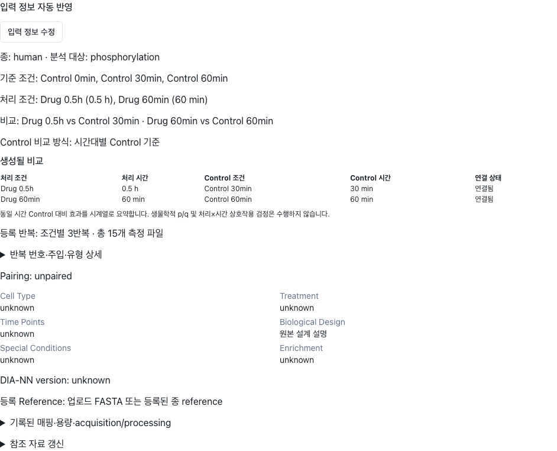

# Control 비교 방식 확장 — C01–C03 로컬 구현·검증 보고

작성: 2026-11-07 (Asia/Seoul). 대상: Xformyx/PTM-platform, `main`.

C01 설계/입력 UI, C02 저장·실행·캐시, C03 효과 시계열·정렬·reader를 구현했다. C04 생물학적 검정 및 C05 Legacy estimator 확장/운영 end-to-end는 이번 구현에 포함하지 않는다. push·배포·flag 변경은 하지 않았다.

## 기준과 변경 경계

- 시작 checkout: `1ad098e8a6506c249fdd4ca13685673201456f55` (이전 Biological Design/등록 반복 표시 개선 적용 상태).
- origin: `https://github.com/Xformyx/PTM-platform.git`. 원격 조회 후 지정한 `42d9a3db8ca92fe1c51a41fb80f7674e7c00d821`로 fast-forward했다. 그 사이 두 커밋은 frontend 공통 JSON build context와 watchdog 변경이었다.
- 구현 기준: `42d9a3db8ca92fe1c51a41fb80f7674e7c00d821`.
- 사용자가 제공한 코드 감사/합성 재현 원문은 [보존 문서](CONTROL_COMPARISON_AUDIT_BASELINE_KO.md)에 별도로 기록했다. 이전 감사 전체를 새로 실행했다고 주장하지 않는다.
- 최초 입력 재사용, Biological Design 호환 키, 등록 Rep. 집계, 계획 기본 3, manifest 후입력 갱신은 기존 구현을 재사용한다.
- 사용자 실제 주문을 식별하거나 DB를 조회하지 않았다. 실제 데이터·발행 ZIP·성공 pointer·pin·미커밋 자료를 변경하지 않았다. 기존 untracked `codex-inputs/`는 커밋하지 않았다.

## 입력과 실행 계약

| 단계 | 저장/소비 필드와 함수 | 동작 |
| --- | --- | --- |
| 최초 Biological Design / 입력 정보 수정 | `StudyInputFields` → `ControlComparisonFields`; `analysis_context.control_comparison` | 두 기본 radio, 접힌 직접 연결. 원본 상태 한 곳에서 편집 |
| 공통 표시 정의 | `ptm_shared/study_display.json` → frontend `CONTROL_COMPARISON`, Python `LABELS` | 표시 문자열과 backend 분기 값을 분리 |
| 요청 policy | `schema_version=control_comparison.v1`, `strategy`, `reference_condition_id`, `arm_control_families`, `mappings`, `source` | 하나의 context 저장 경로. 정책 객체는 기존 merger로 원자 교체, 생략 PATCH는 보존, null은 삭제 |
| 샘플 원본 | `sample_config.samples`/기존 list → `designSamples` → `legacy_samples` | 실제 role/arm/family/condition ID/시간을 유지. 파일 순서·Rep.로 pairing을 만들지 않음 |
| 공통 해석 | `resolve_context` → `resolve_study_design` → `control_comparison.resolve_assignments`; `time_value`/`same_time` | 숫자 시간·family로 연결, 명시된 ID/확정 mapping을 보존하고 국소 오류 반환 |
| canonical 실행 설계 | `study_design.contrasts` 및 `study_design.control_comparison` | 실제 target/reference IDs, pairing, 전략, effect_kind, family, 출처/버전/검증 상태. requested policy와 effective policy/assignments를 구분 |
| 미리보기 | `/orders/resolve-design` → `ControlComparisonPreview` | canonical assignments만 표시. 처리/Control 양쪽 시간·연결 상태. 별도 프런트 matching 없음 |
| 저장·재조회 | 기존 API `_updated_analysis_context`, ORM/JSON 저장 | GET은 기록된 context를 반환. 저장만으로 계산·외부 조회를 실행하지 않음 |
| 실행 직전 / dispatch | 기존 `require_resolved`, `_attach_enrichment_free_profile`, `prepare_astra_inputs`/`capture_order` | 서버가 실제 설계 재검증. preview 대기 중 이전 설계를 제출하지 않는 기존 최신 응답/submit 경로 재사용 |
| worker | 기존 `run_preprocessing` → `run_primary_analysis` | canonical `experimental_context`와 snapshot 전달. raw sample_config도 dispatch에 보존 |
| package | 기존 `write_study_inputs`, `transfer_contract` | `study/study_design.json`, `study_context.json`, 신규 `study/control_comparison.json`, STUDY_BRIEF에 실제 실행 관계·시간·출처 |
| 효과 scope | 신규 작은 공통 `effect_series.resolve_series`/`ordered_contrast_ids` | 기존 단일 reference series ID 유지. matched는 arm/family/effect/design scope별 v2 series 및 실제 point binding |
| reader·그림 | `astra_card_inputs`, `astra_reader*`, `astra_figures` | 실행 snapshot/저장 표에서 정책과 실제 비교를 읽음. 최신 draft로 과거 패키지 문구를 바꾸지 않음 |

`biological_question`의 원문/저장 키와 Biological Design 표시명, 별도의 `research_questions`를 유지했다. 예정 반복 3, 실제 등록 Rep. 수, 주입 수, biological unit 수, pairing은 서로 다른 값으로 유지한다.

## 화면과 자동 연결

| 항목 | 이전 | 변경 후 |
| --- | --- | --- |
| 원본 입력 | 다중 Control 정책을 지정할 공통 입력이 없음 | **Control 비교 방식** / Control comparison strategy |
| 기본 선택 | 단일 reference가 명확해야 자동 연결 가능 | **공통 Control 기준 (Shared control)** / **시간대별 Control 기준 (Time-matched controls)** |
| 직접 연결 | Astra 원본 편집에서 reference 선택이 부족 | 기본 옵션 아래 접힌 **Control 직접 연결**. 열기만으로 정책 변경 없음; 적용 시 `explicit_custom` |
| Astra 생성/재생성 | 기존 단일 Control 중심 요약 | 저장 policy + 실제 target/reference/양쪽 시간/상태를 읽기 전용으로 요약 |
| 시간대별 효과 | 서로 다른 reference마다 1점 series | 대응 family 내 matched 효과 series. 각 점의 실제 reference 보존 |
| method 결과 | reference ID 순서가 시간보다 앞섬 | 효과 series 내부 숫자 분 순서. method p/q·score는 그대로 |

기본 옵션 설명은 요청 문구를 사용한다.

- 공통: “모든 처리 조건을 하나의 지정된 Control 조건과 비교합니다.”
- 시간대별: “각 처리 조건을 같은 시간에 측정한 대응 Control 조건과 비교합니다.”
- 직접 연결: “각 처리 조건에 사용할 Control을 직접 지정합니다.”
- “Control 하나는 조건이 하나라는 뜻입니다. 해당 조건에 등록된 반복 시료를 모두 사용합니다.”

공통 후보가 여러 개인 경우 reference 하나를 선택해도 `shared_reference`를 유지한다. 직접 연결 저장값을 열면 두 기본 radio 모두 미선택이고 현재 직접 연결 상태를 표시한다. native radio/fieldset/legend와 설명·오류의 접근성 연결을 사용한다. 완료 주문 또는 이전 성공 Astra 결과가 남은 실패 주문의 원본 편집에서 실제 mapping이 달라지면 기존 결과 보존/다음 실행 적용 안내를 표시한다.

단일 reference 또는 모든 target에 유일한 동일 시간/family reference가 있는 신규 입력만 자동 제안한다. 과거의 다중 확정 mapping을 time_matched라고 새로 추정하지 않는다. 조건 identity는 명시 ID를 우선하며 같은 label이라도 role/arm/family가 다르면 합치지 않는다. 기존 단일 Control ID와 mapping은 보존한다.

[실제 브라우저에서 확인한 합성 요약 화면](control_comparison_evidence/matched-summary.png): Control 0/30/60분과 Drug 0.5h/60분, 각 Rep. 1–3인 15주입 fixture다. 사용자 실제 주문 화면이 아니다.

## 정량·캐시·시계열 의미

`ContrastEstimator`, `condition_values`, `quantify_contrasts`, whole-study `normalize_supplied_matrices`를 그대로 사용한다. `contrast_quantification.py`의 정량 계산을 변경하지 않았다. 공동 Control을 여러 비교에서 사용해도 주입/material을 복제하지 않는다.

`astra_plan.numeric_design`은 실제 condition/contrast/injection/material/unit/pair/숫자 시간 의존성을 정렬해 기록한다. display label, 시간 원문 표기, 판정 출처 변경만으로 quant fingerprint를 바꾸지 않는다. 실제 reference mapping 변경은 quant 및 후속 discovery/temporal/inference 의존성을 바꾼다. 같은 mapping에서 전략/효과 scope만 변경하면 temporal 의존성으로 구분한다. 코드/의존성 schema가 변경된 이번 업그레이드는 기존 cache fingerprint와 달라질 수 있다.

`quant_cached`는 cache 내부 actual target/reference/arm/pairing/time을 검증한다. 잘못 전달된 이전 fingerprint라도 다른 비교의 수치를 새 label로 재사용하지 않는다. 동일 수치 설계의 label만 달라지면 label projection만 갱신한다. source/annotation pin은 별도 입력이며 mapping 변경으로 지우지 않는다.

matched series의 상위 `reference_condition_id`는 실제 reference가 여러 개면 null이다. 가짜 condition ID를 만들지 않는다. 신규 versioned `temporal/effect_series_points.csv`에 모든 실제 contrast/target/reference/양쪽 시간/pairing/family/effect를 남긴다. 구 단일 reference series ID는 기존 함수를 사용한다. 서로 다른 control family, target arm, baseline과 matched effect는 한 곡선으로 합치지 않는다. mixed pairing은 점별 정보를 보존하고 descriptive 제한을 기록한다.

- `interval_contrasts`: 실제 인접 조건의 `T(t2)-T(t1)`; 기존 단일 기준 경로는 유지한다.
- `effect_interval_contrasts`: `[T(t2)-C(t2)]-[T(t1)-C(t1)]`. 실제 runlevel의 U/P 공동 mask와 각 endpoint의 기존 unit estimator를 사용한다. 양 끝점의 실제 IDs, run IDs, pairing, 주입/집계/biological 수를 별도 보존한다.
- 누락 endpoint를 건너뛴 구간을 만들지 않는다. 시점 간 pair/반복측정을 추정하지 않는다. 차이의 p값·SE·CI·interaction test를 만들지 않는다.
- `baseline_status` 같은 기존 호환 열은 유지하되 실제 0시간 reference 검출과 nonzero reference 검출을 사람용 설명 및 `reference_detection_scope`로 구분한다. 0 효과로의 복귀가 시작 상태 복귀를 뜻하지 않음을 명시한다.
- 카드, protein 시간 요약, temporal, inference ID lookup, 그림, 전체 reader, method_scores 및 저장 PhosX 시간표가 공통 scope를 소비한다. 그림 내부는 공통 영문 label을 사용하고 caption metadata/reader에는 공통 한국어 label을 보존한다.
- 전체 catalog/질문/원본/no-call 접근을 유지하며 selected_findings 수에 분석 범위를 종속시키지 않는다.

## 필요한 입력과 지원 한계

| 상황 | 처리 |
| --- | --- |
| 같은 시간/family Control 없음 | “{처리 조건}: 같은 시간의 대응 Control이 없습니다.” 해당 비교 미해결; 가까운 시간/0분 fallback 없음 |
| 동일 scope 후보가 여러 개 | 후보 수와 해당 관계 보완 안내. 공통 기준 선택 또는 직접 연결/기록된 family 보완 |
| 공통 reference 미선택 | “모든 처리 조건에 사용할 공통 Control을 지정하세요.” |
| 여러 vehicle/family의 대응 관계가 미기록 | 해당 arm의 family만 원본 입력에서 보완 |
| 조건명 자동 분류 | 기존 Control Keyword 정확 일치를 유지. 시간 포함 Control은 원래 Sample Config의 Group을 명시하도록 안내 |
| 필수 시간/실제 충돌/paired mapping 누락 | 기존 resolver/실행 검증 오류 유지. 전체 설계 재입력 요구 없음 |
| 반복 유형·선택 metadata 미기록 | unknown/descriptive 유지. 예정 3 또는 Rep. 번호로 biological n/paired를 만들지 않음 |
| Legacy 다중 Control | 초안은 보존, 실행 직전 API 및 raw config를 받은 worker에서 unsupported 차단. pooling estimator를 확장하지 않음 |
| 운영/과거 queue | 운영 UI·DB·Celery queue는 검증하지 않음. 이미 과거에 병합된 condition_map만 남은 job의 원본 관계를 복원했다고 주장하지 않음 |
| 생물학적 통계 | biological p/q 및 처리×시간 interaction 검정 미지원. PhosX method q를 대체 사용하지 않음 |

## 검증 결과와 실제 실행 경계

**작은 실제 함수 + 합성 데이터**

- C01 초기 회귀 6개가 기존 결함에서 실패하는 것을 먼저 확인한 뒤 구현했다. 현재 정책 테스트는 11개 통과: 숫자 시간(0.5h=30min), 입력 순서, missing/ambiguous, 동일 label 분리, family 구분, 과거 mapping 보존, 잘못된 policy ID 타입 거절 등.
- 5조건×3주입의 정량 fixture: matched 두 contrast에서 U_joint=1, P_joint=0, A=1; 공통 0분 기준은 A=2·3 (절대 오차 1e-12). PR/PG 서로 다른 결측은 공동 mask에만 반영하고 A=U_joint−P_joint 유지.
- 이번 공통 기준 테스트는 등록된 다른 시점 Control도 포함한 **15주입 원본 전체**를 유지한다. 제공된 감사 원문의 공통 Control **9주입 subset**과 입력 범위가 다르다. 원문 결과를 15로 고쳐 쓰거나 동일 실행이라고 보고하지 않는다.
- whole-study normalization 1회, 동일 mapping cache 재사용, reference 변경 시 재계산, 원래 source pin 의존성 분리 검증.
- 변경 전에 `/tmp/ptm-control-baseline`에 저장한 단일 Control fixture와 비교: 정량 DataFrame 13개의 값/ID/NA가 `check_exact=True`로 일치. metadata/추가 표/코드/전체 archive bytes 동일을 주장하지 않는다.
- 6개 matched 시점의 36주입 fixture: 6실제점·1효과 series, 동일 시간 reference 6개 유지, 효과 구간 5개. T 자체 구간 변화=1, matched 효과 구간 변화=0. 중간 reference 결측이면 인접 효과 구간 NA. family/arm 분리, mixed pairing 점별 보존.
- 가상 method 결과의 reference ID/입력 순서 변경 후 1→5→15→30→60→180분 유지. method 값/p/q 불변, effect-series 단조 시간 audit 확인. 저장 PhosX 표의 projection만 검증했으며 native method 계산은 실행하지 않음.

**저장·dispatch·reader**

- 임시 SQLite/실제 FastAPI resolve→업로드 저장→PATCH→GET→`prepare_astra_inputs`→dispatch→실제 worker 분기를 검증했다. broker/Redis와 과학 엔진만 metadata sink로 대역 처리했다. 원래 실행 design과 package metadata의 actual IDs/policy가 일치한다.
- 새 policy 저장 후 material/injection/pairing 보존, 완료 주문 GET 무변경, 기존 입력 재사용 API 테스트 통과.
- actual card/whole-reader 함수와 저장 CSV 재조회가 6점 scope/actual reference/NA를 보존. selected_findings를 비워도 전체 temporal/질문 연결 유지. point binding 변조는 오류.
- 구 단일 reference 저장 표 fixture의 reader/replay 및 v3 schema의 작은 generic bundle replay 회귀 통과. 실제 과거 발행 ZIP을 열어 재실행한 검증은 아니다. 기록된 archive를 새 resolver로 재해석하지 않는다. 구 temporal protein 표에 series_id가 없는 경우 기존 key 계약을 읽는다.
- 한 form·36주입의 작은 합성 v6 패키지 생성·schema/hash 검증 통과 (88 scientific tables, 256 manifest files). 모든 source는 fixture이고 HTTP와 native PhosX 실행은 테스트에서 차단했다. 실제 사용자 ZIP 전체 재생성이나 실제 데이터 분석이 아니다.
- 기존 합성 interruption/immutable reader revision 테스트에서 새 실행/발행 실패 후 이전 성공 pointer/source 보존을 확인했다. 운영 pointer를 조회/수정한 것이 아니다.

**프런트엔드와 테스트 명령**

- 변경 경계 종합 pytest: **77 passed, 1 deselected** (`adapter_called`의 추가 전체 bundle 반복 제외). 이후 저장 method-order 변경에 대한 **8 passed**, 정책 타입 방어/새 정렬에 대한 **12 passed**, 구 generic replay 및 전체 reader **6 passed**를 별도 확인했다. 중복 테스트를 합산한 총계가 아니다.
- `node --experimental-strip-types --test frontend/tests/analysisContext.test.ts`: **9 passed**.
- `npm run build --prefix frontend`: **통과**, 3210 modules. 기존 Browserslist 데이터/큰 chunk 경고는 남아 있다.
- `scripts/validate_control_comparison_browser.py`: **통과**, page errors 0, 실제 resolver 호출 11회. API의 보조 응답만 fixture로 대역; 신규/재생성·직접 연결·공통 nonzero 시간·키보드·지연 응답·미해결 draft 저장·이전 성공 결과가 있는 실패 주문의 변경 안내를 확인했다. [검증 기록](control_comparison_evidence/browser-validation.json).
- `git diff --check`: 통과.

재현용 Python 환경: `codex-inputs/round11-20261010/runtime/bin/python`, `PYTHONPATH=api-server:workers:.:ptm_shared/tests`. 이 환경/원본 자료는 커밋하지 않는다. 관련 테스트는 `ptm_shared/tests/test_control_comparison.py`, `test_control_quantification.py`, `test_control_effect_series.py`, `api-server/tests/test_control_comparison_roundtrip.py`에 보존한다.

## 로컬 커밋

- C01 `0363e31758ccc652e5d8d397491ea01d3af37e3d` — 설계 policy/조건 identity/원본 UI/Legacy 실행 방어.
- C02 `f3d22903605b9c8a2232a4a368a67c7d3492f6de` — 실제 mapping의 정량 cache 의존성/실행 metadata 및 저장·dispatch 검증.
- C03 `61ebd7e1b44b77b72b9eb16994b7821454e94f5d` — 공통 효과 series/구간 차이/정렬/카드/전체 reader/작은 합성 패키지 검증.
- 이 보고서와 제공 감사 원문/작은 UI 증거는 별도 문서 커밋으로 기록한다. 보고서 자체 커밋 SHA는 자기 참조를 만들지 않고 `git log`에서 확인한다.

운영 미반영: 로컬 구현·합성 검증·로컬 커밋만 완료했다. 원격 push, 배포, flag 변경, 운영 end-to-end는 수행하지 않았다.

## 수정 파일 목록 (C01–C03)

- [api-server/app/api/orders.py](../../api-server/app/api/orders.py)
- [api-server/tests/test_control_comparison_roundtrip.py](../../api-server/tests/test_control_comparison_roundtrip.py)
- [frontend/src/components/CanonicalStudyFields.tsx](../../frontend/src/components/CanonicalStudyFields.tsx)
- [frontend/src/components/ControlComparisonFields.tsx](../../frontend/src/components/ControlComparisonFields.tsx)
- [frontend/src/components/RerunOptionsModal.tsx](../../frontend/src/components/RerunOptionsModal.tsx)
- [frontend/src/components/StudyInputFields.tsx](../../frontend/src/components/StudyInputFields.tsx)
- [frontend/src/lib/analysisContext.ts](../../frontend/src/lib/analysisContext.ts)
- [frontend/src/pages/OrderCreate.tsx](../../frontend/src/pages/OrderCreate.tsx)
- [frontend/tests/controlComparison.browser.html](../../frontend/tests/controlComparison.browser.html)
- [frontend/tests/controlComparison.browser.tsx](../../frontend/tests/controlComparison.browser.tsx)
- [ptm_shared/analysis_context.py](../../ptm_shared/analysis_context.py)
- [ptm_shared/astra_card_inputs.py](../../ptm_shared/astra_card_inputs.py)
- [ptm_shared/astra_evidence.py](../../ptm_shared/astra_evidence.py)
- [ptm_shared/astra_evidence_v6.py](../../ptm_shared/astra_evidence_v6.py)
- [ptm_shared/astra_figures.py](../../ptm_shared/astra_figures.py)
- [ptm_shared/astra_inputs.py](../../ptm_shared/astra_inputs.py)
- [ptm_shared/astra_package.py](../../ptm_shared/astra_package.py)
- [ptm_shared/astra_plan.py](../../ptm_shared/astra_plan.py)
- [ptm_shared/astra_reader.py](../../ptm_shared/astra_reader.py)
- [ptm_shared/astra_reader_full.py](../../ptm_shared/astra_reader_full.py)
- [ptm_shared/astra_reader_temporal.py](../../ptm_shared/astra_reader_temporal.py)
- [ptm_shared/astra_science.py](../../ptm_shared/astra_science.py)
- [ptm_shared/astra_temporal.py](../../ptm_shared/astra_temporal.py)
- [ptm_shared/control_comparison.py](../../ptm_shared/control_comparison.py)
- [ptm_shared/effect_series.py](../../ptm_shared/effect_series.py)
- [ptm_shared/evidence_temporal.py](../../ptm_shared/evidence_temporal.py)
- [ptm_shared/generic_workflow.py](../../ptm_shared/generic_workflow.py)
- [ptm_shared/science_inference.py](../../ptm_shared/science_inference.py)
- [ptm_shared/study_design.py](../../ptm_shared/study_design.py)
- [ptm_shared/study_design.v4.schema.json](../../ptm_shared/study_design.v4.schema.json)
- [ptm_shared/study_display.json](../../ptm_shared/study_display.json)
- [ptm_shared/tests/test_control_comparison.py](../../ptm_shared/tests/test_control_comparison.py)
- [ptm_shared/tests/test_control_effect_series.py](../../ptm_shared/tests/test_control_effect_series.py)
- [ptm_shared/tests/test_control_quantification.py](../../ptm_shared/tests/test_control_quantification.py)
- [scripts/validate_control_comparison_browser.py](../../scripts/validate_control_comparison_browser.py)
- [workers/preprocessing/tasks.py](../../workers/preprocessing/tasks.py)
